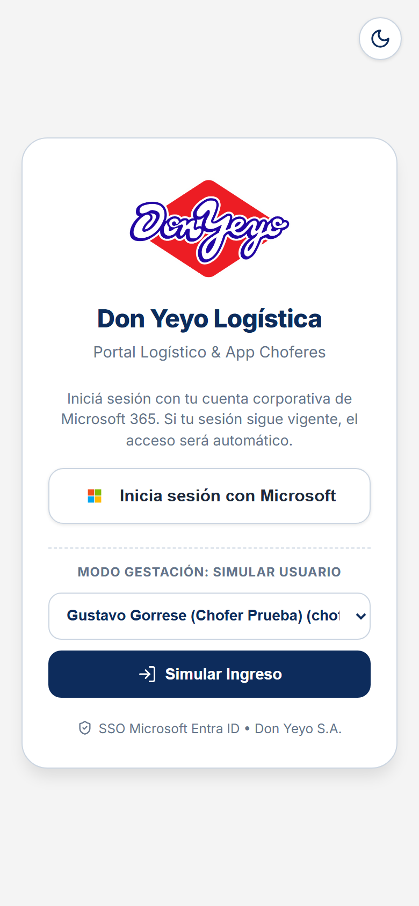
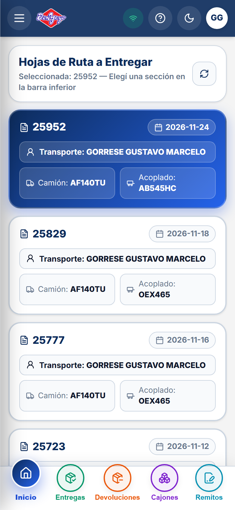
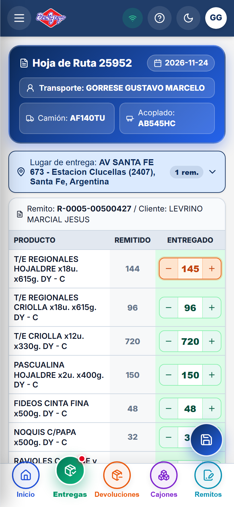
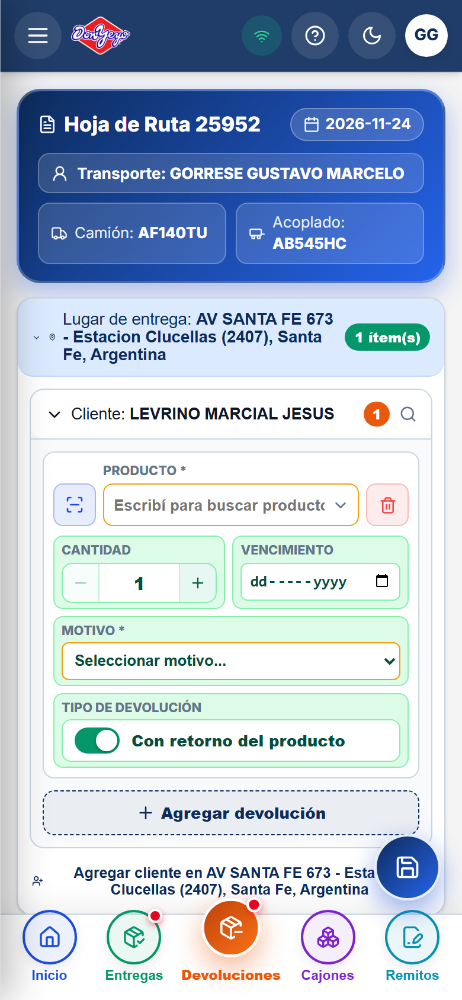
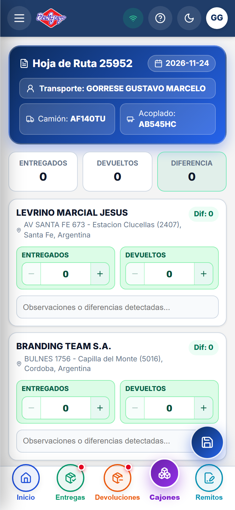
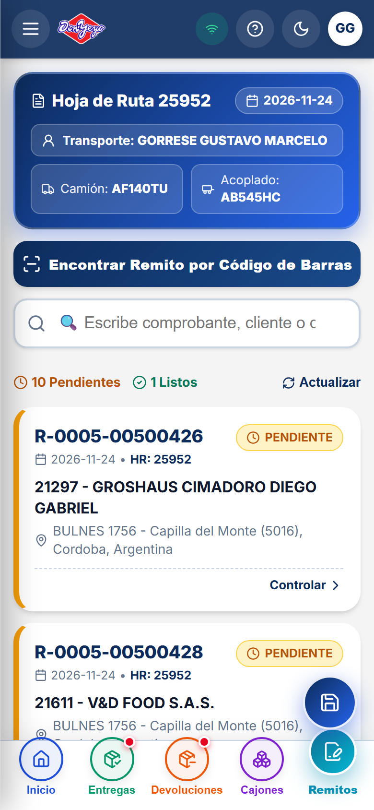
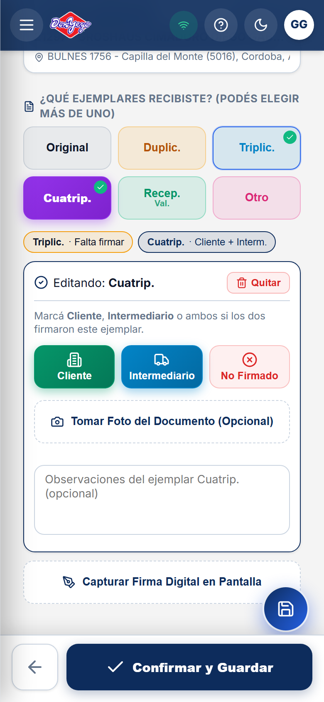
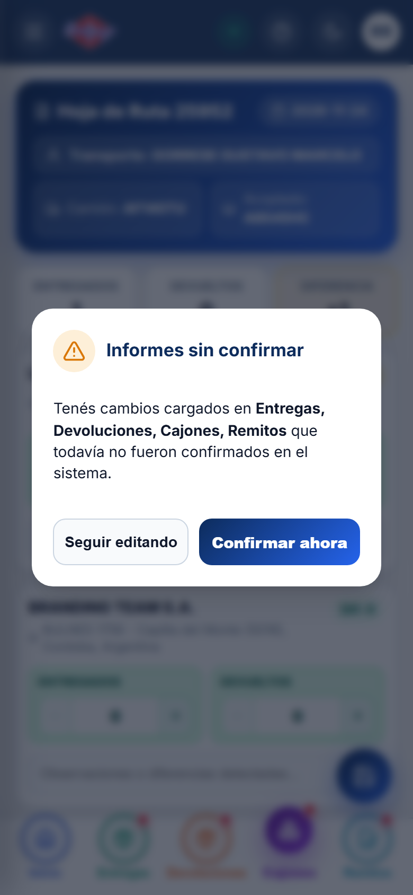
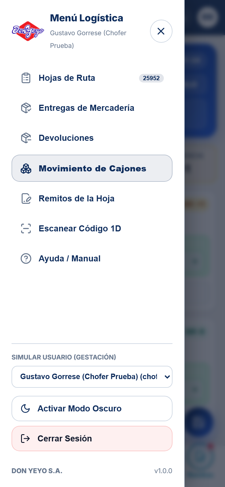

# Manual de Usuario — App Móvil para Choferes
**Don Yeyo Logística · Guía paso a paso**

---

## 1. ¿Para qué sirve esta aplicación?

Esta aplicación te permite registrar desde tu celular todo lo que pasa en tu recorrido de reparto de manera rápida y ordenada:

1. **Confirmar qué mercadería se entregó** en cada parada.
2. **Anotar devoluciones** si un cliente devuelve algún producto (con lector de código de barras o buscador).
3. **Controlar la entrega y devolución de cajones** en cada parada.
4. **Registrar la recepción y firma de los remitos**, sacando foto si hace falta y guardando la firma en pantalla.

> **Importante:** Todo lo que vas cargando queda guardado temporalmente en tu teléfono aunque cambies de pantalla o te quedes sin señal en la ruta.

---

## 2. Cómo ingresar a la aplicación

1. Abrí la aplicación **Don Yeyo Logística** desde el celular.
2. Tocá el botón **"Inicia sesión con Microsoft"** e ingresá con tu correo corporativo de Don Yeyo.
3. Si ya habías iniciado sesión hace poco, la aplicación entra directo sin volver a pedirte la clave.
4. En la esquina superior derecha podés tocar el ícono de la **luna / sol** si preferís usar pantalla oscura (ideal para manejar de noche) o clara.

---

## 3. Elegir tu Hoja de Ruta (Pantalla Inicio)

Al entrar vas a ver el listado de **Hojas de Ruta** asignadas a tu recorrido.

Cada tarjeta muestra en forma clara:
* El **número de Hoja de Ruta** y la **fecha**.
* El nombre del **Transporte**.
* La patente del **Camión** y del **Acoplado**.

### Cómo empezar a trabajar:
1. **Tocá la tarjeta** de la Hoja de Ruta con la que vas a trabajar.
2. Vas a notar que la tarjeta seleccionada se pinta de **azul** para que siempre sepas en qué viaje estás parado.
3. En la **barra inferior de colores** tenés las 5 secciones principales:
   * **Inicio** (azul)
   * **Entregas** (verde)
   * **Devoluciones** (naranja)
   * **Cajones** (violeta)
   * **Remitos** (celeste)

> Antes de elegir una Hoja de Ruta, los botones de abajo no te dejan entrar a cargar datos para evitar confusiones entre viajes.

---

## 4. Confirmar Entregas

En la pestaña verde **Entregas** confirmás la mercadería que descargaste en cada destino.

* Arriba siempre ves la tarjeta azul recordándote en qué **Hoja de Ruta** estás trabajando.
* Los destinos aparecen agrupados por **Lugar de entrega** en formato desplegable (acordeón). Al principio están cerrados para que la pantalla quede ordenada.
* **Tocá un Lugar de entrega** para abrirlo y ver sus remitos y productos. Podés dejar varios lugares abiertos al mismo tiempo; si cambiás de pantalla y volvés, van a seguir abiertos tal como los dejaste.

### Cómo cargar la cantidad entregada:
* Por defecto, el campo **Entregado** ya viene cargado con la misma cantidad de **Remitido** (asumiendo que se entregó todo).
* Si entregaste una cantidad distinta, podés ajustarla de dos maneras:
  * Usando los botones **`-`** y **`+`** que están a los costados del número.
  * Tocando el número: **se selecciona solo** para que puedas escribir la nueva cantidad directo sin tener que borrar dígito por dígito.
* Cuando un número es distinto a lo remitido, **cambia de color** para que a simple vista identifiques dónde hubo diferencias.

---

## 5. Registrar Devoluciones

En la pestaña naranja **Devoluciones** anotás la mercadería que vuelve o que tuvo algún inconveniente en un cliente.

1. Abrí el **Lugar de entrega** y luego el **Cliente** donde querés cargar la devolución (si el cliente no figura en la lista, podés tocar **"Agregar cliente"** para buscarlo y sumarlo).
2. Tocá el botón **"Agregar devolución"** para abrir una fila nueva de carga.
3. Completá los datos de cada producto devuelto:
   * **Código de barras / MTX** *(botón de escáner a la izquierda del producto)*: tocá ese botón para abrir la cámara y escanear el código de barras del producto, o ingresá manualmente su código **MTX**. El sistema busca y selecciona automáticamente el producto coincidente.
   * **Producto:** también podés escribir parte del nombre para filtrar la lista y elegir una de las opciones disponibles. *(Si salís sin elegir ningún producto de la lista, el texto se limpia solo para evitar errores de carga).*
   * **Cantidad:** ajustala con **`-`** y **`+`** o escribiendo el número.
   * **Vencimiento:** si corresponde, elegí la fecha de vencimiento del producto.
   * **Motivo *(obligatorio)*:** elegí el motivo de la lista (viene ordenada alfabéticamente de la A a la Z). Es obligatorio elegir uno para poder confirmar.
   * **Tipo de devolución (interruptor):**
     * **Activado ("Con retorno del producto"):** por defecto viene activado; úsalo cuando traés físicamente la mercadería devuelta arriba del camión.
     * **Desactivado ("Sin retorno del producto"):** usalo cuando la diferencia/devolución no vuelve físicamente en el camión.
4. Si te equivocaste al agregar una fila nueva, podés quitarla con el botón del tacho rojo.

---

## 6. Controlar Cajones

En la pestaña violeta **Cajones** llevás el control de envases/cajones entregados y retirados en cada parada.

* Cada tarjeta muestra el **Cliente**, el **Lugar de entrega** y una etiqueta con la **Diferencia** calculada sola (`Entregados - Devueltos`).
* Usá los botones **`-`** y **`+`** (o tocá el número para escribir directo) en:
  * **Entregados**
  * **Devueltos**
* Podés escribir **Observaciones** si hubo roturas o aclaraciones.
* Si necesitás sumar una parada o cliente que no estaba en la lista, usá el botón **"Agregar otro cliente / parada"**.

---

## 7. Registrar Remitos (Escaneo, varios ejemplares y firmas)

En la pestaña celeste **Remitos** controlás los comprobantes entregados en el viaje.

### Buscar o escanear un remito
* Podés tocar el botón azul **"Encontrar Remito por Código de Barras"** para abrir la cámara y apuntar al código de barras 1D del remito (o escribir el número manualmente).
* También podés escribir el número de comprobante, cliente o domicilio en el buscador para filtrarlo de la lista.
* Arriba ves cuántos remitos están **Pendientes** y cuántos **Listos**, además del resumen en cada tarjeta.

### Cargar uno o varios ejemplares y quién los firmó
Al tocar un remito se abre su ficha de control:

1. **Elegí qué ejemplares recibiste:** podés marcar **uno o más de uno** tocando los botones (`Original`, `Duplic.`, `Triplic.`, `Cuatrip.`, `Recep. Val.`, `Otro`).
   * Por ejemplo: si el cliente te firmó el **Cuatriplicado** y un intermediario te firmó el **Triplicado**, podés cargar los dos ejemplares dentro del mismo remito.
   * Los ejemplares incluidos muestran un tilde verde y aparecen como pestañas debajo para que pases de uno a otro tocándolos.
2. **Para cada ejemplar seleccionado indicá quién lo firmó:**
   * Podés marcar **Cliente**, **Intermediario**, o **ambos a la vez** si los dos firmaron ese mismo papel.
   * Si el papel volvió sin firma, marcá **No Firmado**.
3. **Foto y observaciones propias de cada ejemplar:**
   * Podés usar **"Tomar Foto del Documento (Opcional)"** para sacarle foto a ese ejemplar puntual y anotarle una observación si hace falta.
4. **Firma Digital en Pantalla (opcional):** al pie podés tocar **"Capturar Firma Digital en Pantalla"** para que quien recibe firme con el dedo en el celular y deje su aclaración/DNI.
5. Podés guardar ese remito al instante con **"Confirmar y Guardar"** en la barra inferior, o volver atrás y confirmarlo junto con todo el resto de la Hoja de Ruta desde el botón azul flotante.

---

## 8. Cómo guardar tus cambios (Puntitos rojos, Botón Azul y Recordatorio)

Para que sea más cómodo y no tengas que ir hasta el final de cada pantalla para apretar un botón de guardar:

### 1. Memoria entre pantallas y puntitos rojos
* Si cargás un dato en **Entregas**, pasás a **Devoluciones**, después a **Cajones** o **Remitos**, **no perdés nada**: todo queda recordado en el celular hasta que lo confirmes.
* Cada sección que tenga cambios cargados sin confirmar va a mostrar un **puntito rojo** arriba de su ícono en la barra de abajo.

### 2. Botón flotante azul (Guardado Global)
* Mientras tengas al menos una modificación sin confirmar (o entregas sin confirmar en el sistema), vas a ver un **botón redondo azul con el ícono de guardar** siempre fijo arriba a la derecha de la barra inferior, **sin importar en qué pantalla estés**.
* Al tocar ese botón azul, **la aplicación guarda juntos todos los cambios** que hiciste en Entregas, Devoluciones, Cajones y Remitos de esa Hoja de Ruta.
* Mientras se envían los datos al sistema, la pantalla se bloquea unos segundos mostrando un círculo girando con el aviso **"Guardando cambios..."** para evitar toques duplicados por error.

### 3. Recordatorio automático ("Informes sin confirmar")
* Si hiciste cambios y dejaste pasar un tiempo sin confirmarlos, la aplicación te va a mostrar un cartel en el centro de la pantalla avisándote en qué secciones tenés cambios pendientes:
  * **Seguir editando:** cierra el aviso para que sigas cargando cosas tranquilo.
  * **Confirmar ahora:** guarda y confirma todos los cambios pendientes en ese momento.

---

## 9. Menú lateral, Modo Oscuro, Ayuda y Uso sin Señal

### Menú lateral y barras superiores
* Tocando el botón de las **tres rayitas** arriba a la izquierda se abre el menú lateral para saltar directo a cualquier sección, cambiar entre **Modo Claro / Modo Oscuro**, abrir la **Ayuda / Manual** o **Cerrar Sesión**.
* En la barra superior también tenés accesos rápidos para ver el estado de señal (**Con conexión** / **Sin conexión**), abrir el asistente de **Ayuda (`?`)** y cambiar el tema.

### ¿Qué pasa si me quedo sin señal en la ruta?
* Podés seguir usando toda la aplicación igual: cargar entregas, devoluciones, cajones, remitos, fotos y firmas.
* Si apretás guardar mientras estás sin señal (o si Internet falla en ese momento), tus datos **se guardan de forma segura en la memoria interna temporal del teléfono**.
* Apenas recuperes señal de datos o WiFi, la aplicación **envía automáticamente** los registros pendientes al sistema central sin que tengas que volver a cargarlos.

---

## 10. Preguntas frecuentes rápidas

* **¿Puedo cambiar de pantalla sin haber apretado guardar todavía?**
  Sí. Tus cambios quedan guardados en el borrador del celular y ves un puntito rojo sobre la sección pendiente. Cuando quieras confirmar todo junto, tocá el botón azul flotante.
* **¿Por qué en Entregas un número cambió de color?**
  Porque el valor de **Entregado** que pusiste es distinto al **Remitido** original. Sirve para que lo veas rápido antes de confirmar.
* **¿Qué pasa si en Devoluciones escribo un producto pero no elijo ninguno de la lista?**
  Al tocar fuera del campo, se limpia el texto para asegurar que siempre quede seleccionado un producto real del catálogo.
* **¿Es obligatorio elegir un Motivo en Devoluciones?**
  Sí, cada producto devuelto tiene que tener un motivo seleccionado antes de confirmar.
* **¿Qué hago si necesito volver atrás después de entrar a un remito?**
  Tocá el botón con la flecha **`←`** abajo a la izquierda. Si ya habías marcado ejemplares o firmas, quedan recordados hasta que los confirmes.
